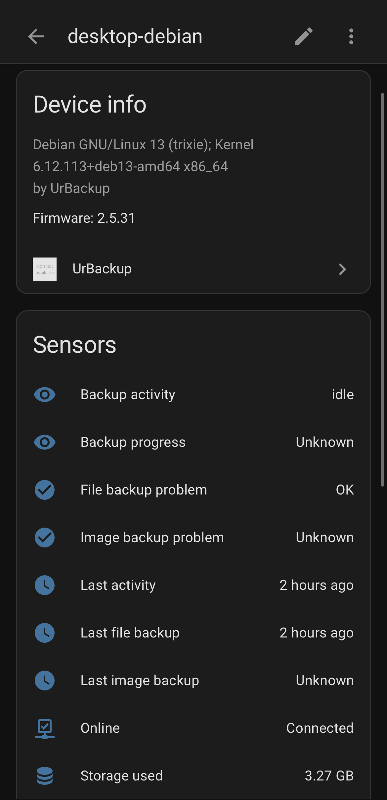
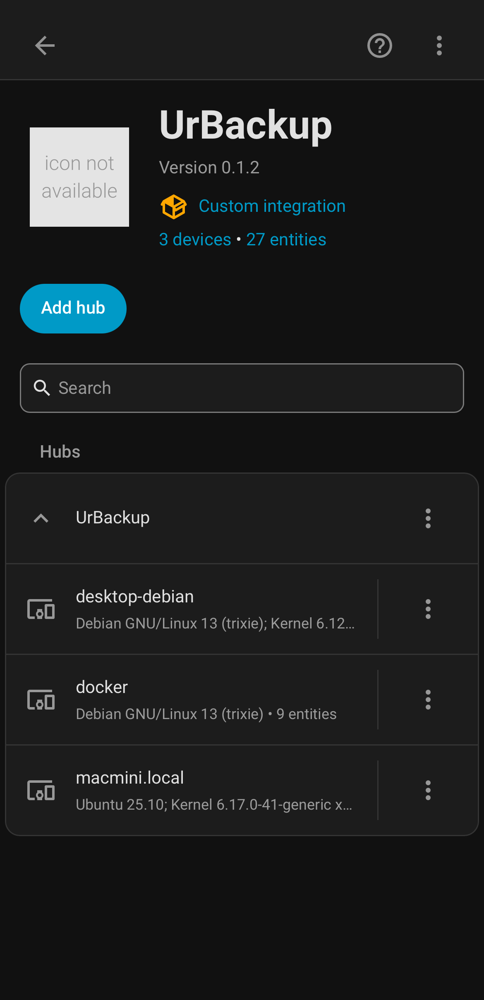
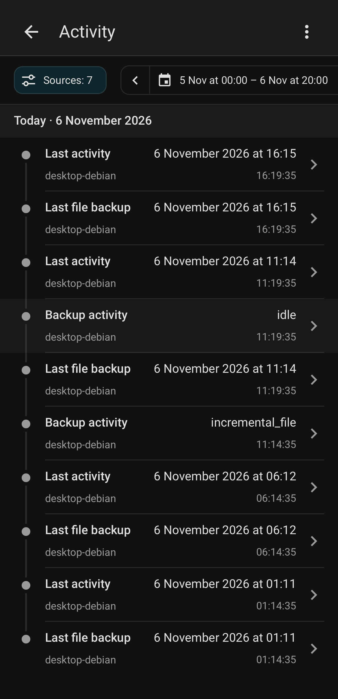
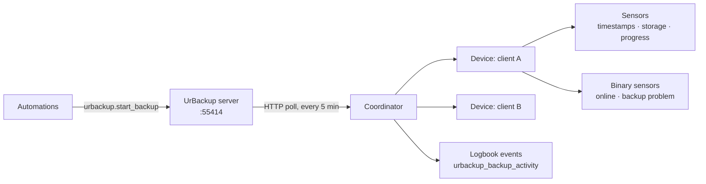

# UrBackup Monitor for Home Assistant

Monitors an [UrBackup](https://www.urbackup.org/) server from Home Assistant:
every backup client becomes a device, with backup timestamps, storage usage,
live progress and health — plus a service call to start a backup and logbook
events to automate on.

[](https://hacs.xyz/)
[](https://www.home-assistant.io/)

[](LICENSE)

<table>
  <tr>
    <td width="33%"></td>
    <td width="33%"></td>
    <td width="33%"></td>
  </tr>
  <tr>
    <td align="center"><sub>Every client is a device</sub></td>
    <td align="center"><sub>Clients are discovered automatically</sub></td>
    <td align="center"><sub>Backups land in the logbook</sub></td>
  </tr>
</table>

> [!NOTE]
> This is a fork of [whallil/ha-urbackup-monitor](https://github.com/whallil/ha-urbackup-monitor)
> with three bug fixes, including a storage figure that read 7.4% low on every
> client. Details in [Why this fork exists](#why-this-fork-exists).

## Install

### HACS

1. **HACS** → three-dot menu → **Custom repositories**
2. Add `theseal666/ha-urbackup-monitor`, category **Integration**
3. **Download**, then restart Home Assistant

### Manual

Copy `custom_components/urbackup` into your Home Assistant `custom_components/`
directory and restart.

## Configure

**Settings → Devices & Services → Add Integration → UrBackup**, then enter the
server URL. Username and password are optional — leave them blank for
anonymous access.

All of these work:

| Entered | Becomes |
|---|---|
| `nas.lan` | `http://nas.lan:55414` — default port added |
| `nas.lan:55414` | kept as-is |
| `https://backup.example.com` | kept as-is — explicit scheme untouched, so a reverse proxy on 443 works |

> [!TIP]
> The integration polls every 5 minutes. Backup *events* arrive on that same
> poll, so a logbook entry or automation can lag a completed backup by up to
> five minutes. Fine for notifications, not a live progress bar.

## How it works



The integration polls the UrBackup server's web API every five minutes and
builds one Home Assistant device per backup client.

## Entities

Each UrBackup client becomes its own device.

| Sensor | What it reports |
|---|---|
| Last file backup | Timestamp of the last completed file backup |
| Last image backup | Timestamp of the last completed image backup |
| Storage used | Decimal GB — attributes: `files_gb`, `images_gb` |
| Backup activity | Current action: `idle`, `incremental_file`, `full_file`, `nightly_cleanup`, … |
| Backup progress | Percent complete — attributes: `speed_mbps`, `eta_seconds` |
| Last activity | Timestamp of the most recent activity — attributes: `backup_type`, `duration`, `size_gb` |

| Binary sensor | On when |
|---|---|
| Online | The client is currently connected |
| File backup problem | File backups are failing |
| Image backup problem | Image backups are failing |

## Start a backup

```yaml
service: urbackup.start_backup
data:
  client_id: 4
  backup_type: full_file
```

`client_id` is required. `backup_type` defaults to `incr_file`; the others are
`full_file`, `incr_image` and `full_image`.

> [!NOTE]
> Home Assistant 2024.8+ renamed services to **actions** in the UI and accepts
> `action:` in place of `service:` in YAML. The `service:` spelling above still
> works on every version and is what this integration's stated minimum
> (2024.1.0) requires.

## Automate on backup results

The integration fires `urbackup_backup_activity` when a backup completes,
fails or is deleted. These show up in the logbook and work as automation
triggers.

<details>
<summary>Event fields</summary>

| Field | Description |
|---|---|
| `client_name` | Name of the backup client |
| `client_id` | UrBackup client ID |
| `message` | Human-readable summary |
| `backup_type` | `file` or `image` |
| `incremental` | Whether the backup was incremental |
| `duration_seconds` | How long it took |
| `size_bytes` | Backup size |

</details>

Notify when a client's file backups start failing:

```yaml
automation:
  - trigger:
      - platform: state
        entity_id: binary_sensor.urbackup_dev3_file_backup_problem
        to: "on"
    action:
      - service: notify.mobile_app
        data:
          message: "UrBackup: file backup problem on dev3"
```

## Troubleshooting

<details>
<summary>Setup fails with "cannot connect"</summary>

Usually the wrong port — pointing at another web UI returns HTML instead of
JSON. UrBackup's web interface defaults to **55414**. Open
`http://your-server:55414` in a browser and confirm you get UrBackup's login
page before adding the integration. Timeouts surface the same way.

</details>

<details>
<summary>Storage figures disagree with the UrBackup web UI</summary>

This integration reports **decimal GB** (10⁹ bytes), matching the unit Home
Assistant declares. Tools that report gibibytes (2³⁰) under a "GB" label will
read about 7.4% lower for the same data. The upstream integration had this
bug — see below.

</details>

<details>
<summary>No devices appear after setup</summary>

Clients only show up once UrBackup knows about them. Check the server's own
status page lists them, and that the account you configured can see them —
a restricted user may have a narrower view than the admin.

</details>

## Why this fork exists

<details>
<summary>Three fixes against upstream</summary>

- **Storage sensors reported gibibytes under a GB label.** `_bytes_to_gb`
  divided by 1024³ while the sensor declares `UnitOfInformation.GIGABYTES`,
  which Home Assistant treats as 10⁹ — every storage figure came out 7.4% low,
  and HA's own unit conversions inherited the error. Now decimal GB.
- **`host:port` without a scheme produced a double port.** Entering
  `nas.lan:55414` in the config flow became `http://nas.lan:55414:55414` and
  could not connect. URL normalization is now a single tested function: a bare
  host gets the default port, a host that already has one keeps it, and an
  explicit scheme is left untouched so a reverse proxy on 80/443 still works.
- **Wrong-port setups failed with "Unexpected error".** A non-JSON reply (the
  usual symptom of pointing at another web UI) raised `JSONDecodeError` straight
  through the config flow. Non-JSON replies and timeouts now surface as
  "cannot connect".

</details>

## Requirements

UrBackup Server 2.x+ · Home Assistant 2024.1.0+ · HACS 2.0.0+

## Brand icon

Home Assistant shows "icon not available" for integrations it has no brand
images for. [`custom_components/urbackup/brand/`](custom_components/urbackup/brand/)
holds an icon for this one.

Home Assistant 2026.3 and newer load it from there directly — local images take
priority over the brands CDN, and no pull request against home-assistant/brands
is needed. Older versions ignore it and keep showing the placeholder; see
[the brand README](custom_components/urbackup/brand/README.md) for that
fallback and for how to regenerate the files.

## License

[GNU AGPL v3.0](LICENSE) — the same license UrBackup uses.
